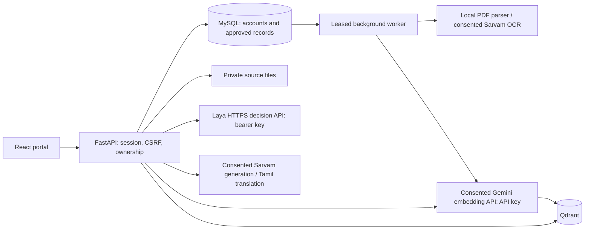

# Architecture

MySQL is authoritative. Main tables are `users`, `patients`, `sessions`, `login_attempts`, `documents`, `extractions`, `observations`, `medications`, `summaries`, `jobs`, `source_chunks`, `conversations`, `messages`, `audit_events`, and `worker_heartbeats`. Clinical rows carry patient/document/revision ownership. MySQL timestamps retain microseconds to avoid lease and immediate-queue ordering errors.

An upload returns 202 and queues extraction. Embedded PDF text stays local; scanned pages use Sarvam only with consent checked before each page. Review revisions are stored separately. Confirmation writes only selected observations/medications and approved field passages; extraction text that has not been approved never becomes a retrieval source.

Passages represent individual approved records and retain up to 900 characters of the original excerpt for human citation checks. Structured fields and dates are the machine's authoritative evidence. Original OCR values are excluded from generation/validation when fields have been corrected. Large indexing jobs embed in batches. General unreviewed narrative pages are deliberately excluded; discharge details can be added as reviewed fields, but unrestricted document chat is outside this prototype.

Laya selects `records`, `trends`, `narrative`, or `unsupported`. Exact record/trend requests select current approved SQL passages; narrative requests search Qdrant with a patient filter. Every vector result is checked against SQL to discard stale/deleted/unapproved revisions. Laya ranks relevance; Sarvam generates English claims with source IDs; deterministic checks reject invalid citations, unseen numbers/units and treatment-changing phrases; Laya separately checks each claim for support. Low confidence produces abstention. English/Tamil output retains source links.

For Windows, `app.vector_server` uses Qdrant's persistent local engine behind an authenticated REST subset. It supports the operations this app needs, runs in one process, and serializes engine access. Docker uses the official Qdrant server. Neither vector store is the source of truth.

All model inference uses backend API keys. [Laya decisions](https://laya-model.com/docs/api) use `POST /v1/decide`, bearer authentication, typed questions and explicit `model: multilingual`; gateway routing metadata is optional. This is the independent laya-model.com gateway. [Google Gemini embeddings](https://ai.google.dev/api/embeddings) use `gemini-embedding-001` with 1536 dimensions and `x-goog-api-key: GEMINI_API_KEY`. Native batch requests distinguish `RETRIEVAL_DOCUMENT` and `RETRIEVAL_QUERY`; responses preserve request order. Reduced-dimension vectors are normalized before storage/search. A collection suffix derived from the provider, model, dimensions and retrieval protocol prevents mixing incompatible vectors; reindex approved documents when switching models or providers. [Sarvam chat](https://docs.sarvam.ai/api-reference/chat/chat-completions-v1), OCR and translation use its subscription key. Missing credentials, rejected keys, insufficient credits, malformed provider output and outages produce explicit failures. No local or anonymous fallback exists.

Consent names Laya, Google Gemini and Sarvam and is checked with fresh SQL state before every decision, embedding batch, generation and translation request. Sources are revalidated before sending their content. Revocation cannot retract a request already sent; it prevents subsequent requests and result publication. Provider credentials are never sent to the browser. Migration 0003 resets existing Sarvam-only consent; migration 0004 refreshes consent and indexing state when embeddings switch to Google. Clinical SQL rows and source documents are preserved.

Workers renew job leases and save results only while their token and document revision are current. Deletion immediately removes eligibility and queues file/vector cleanup. SQL checks prevent a delayed vector deletion or stale worker result from exposing deleted evidence. Editing also clears stored assistant answers that cited the changed document.
